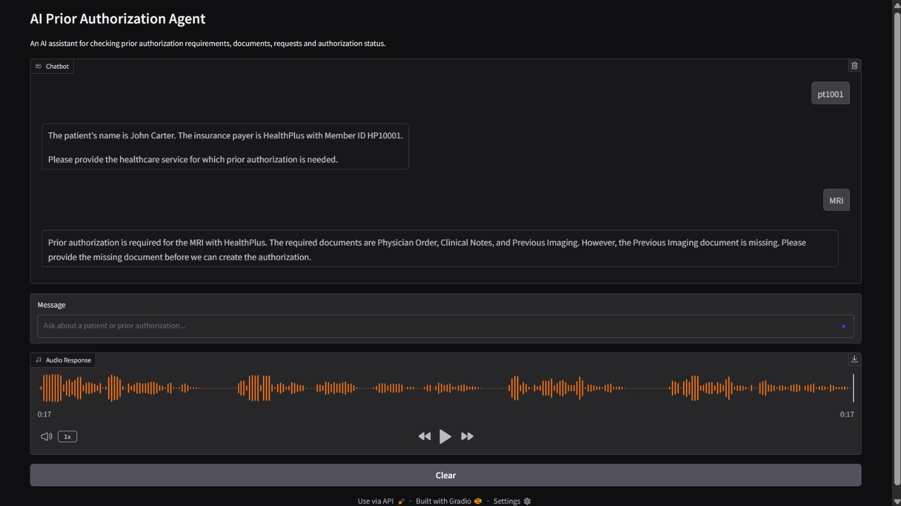

# AI Prior Authorization Agent
A healthcare assistant that checks insurance authorization requirements, verifies supporting documents, and helps manage prior authorization requests.

## Objective
To simplify the prior authorization process by identifying missing documents and checking insurance requirements before submitting requests.

## Steps Followed
1. Imported Python libraries and configured the OpenAI API.
2. Created a SQLite database with sample patient and insurance information.
3. Added patient records, insurance requirements, and supporting documents.
4. Created a function to retrieve patient information.
5. Built a function to check whether a medical service requires prior authorization.
6. Implemented document verification to identify missing documents.
7. Created functions to generate authorization requests and retrieve their status.
8. Connected the database functions to the AI model using tool calling.
9. Built an interactive chatbot using Gradio.
10. Added text-to-speech functionality for spoken responses.
11. Created an interface displaying chatbot messages and audio responses.
12. Tested the application using patient PT1001 and an MRI authorization request.

## Outcome
Developed a healthcare authorization assistant that retrieves patient information, checks insurance requirements, and identifies missing documents.

During testing, the assistant identified that HealthPlus required prior authorization for an MRI and detected that Previous Imaging was missing. It also generated a spoken explanation of the result.

## Project Interface

